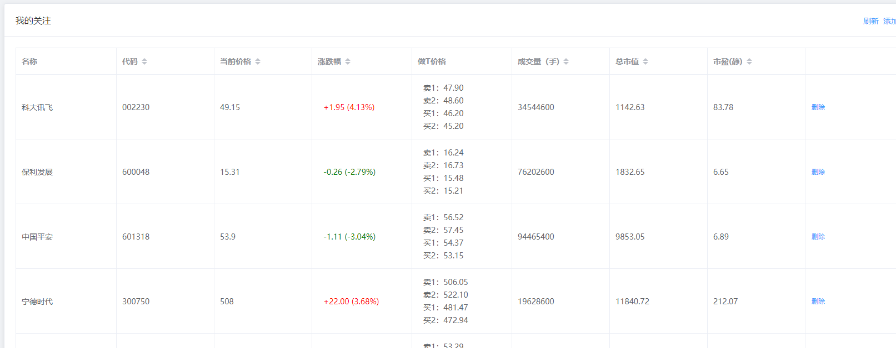

# pytrader

[English README](README_EN.md) | [中文说明](README.md)

基于 [easytrader](https://github.com/shidenggui/easytrader) 和 [easyquotation](https://github.com/shidenggui/easyquotation) 的量化交易框架，支持东方财富自动交易。

## 当前维护计划

本项目当前按个人开源项目维护，优先保证现有功能可用和兼容，不承诺固定发布周期。

- 优先修复会影响安装、启动、交易执行、回测结果的实际问题。
- 优先接受小而明确的修复，不接受没有真实场景支撑的大规模重构。
- Web 前端和自动交易能力以现有实现为基础逐步维护。
- 破坏性变更需要明确迁移说明。

## Roadmap

- 完善安装、配置、回测和在线交易文档。
- 补充示例配置文件，避免文档中出现真实账号字段。
- 梳理策略模板和回测示例，降低新策略接入成本。
- 增加关键路径的最小测试，覆盖配置加载、策略加载和基础回测流程。

## 安全边界

不要提交真实券商账号、密码、token、session、行情服务 key 或任何生产凭据。

- `account.json`、`yjb_account.json`、`jqdata.json`、`tushare.json`、`*.session`、`*.local` 等文件只能保存在本地或部署环境。
- 仓库示例只能使用占位符，不要把真实资金账号写入代码、README、issue 或提交记录。
- 使用真实账户前，必须先在测试环境确认策略、风控、下单路径和异常处理。
- 本项目不托管凭据，不替用户承担券商认证、资金安全或交易风险。

## 非投资建议声明

本项目只提供量化交易、行情获取、策略执行和回测相关的工程代码示例，不构成任何投资建议、收益承诺或交易指令。使用者应自行判断策略风险，并自行承担实盘交易造成的损失。

## License

本项目采用 MIT License，详见 [LICENSE](LICENSE)。第三方依赖和上游项目保留其各自许可证。

## 安装

    pip3 install -r requirements.txt

- 手动安装`talib`依赖, [talib](https://www.lfd.uci.edu/~gohlke/pythonlibs/#ta-lib)

## Web 系统与 API 服务

本项目提供了一个配套的 Web 前端和 API 服务，用于实时监控自选股状态及进行 T 操作定价。

- **自选股监控**：支持自选股添加与剔除，通过 QQ 行情接口提供实时报价。
- **自动交易接口**：集成买入 `/api/buy` 与卖出 `/api/sell` API，并已严格引入 JWT 身份鉴权以确保交易安全。



## 策略文件

在strategies目录，可以参考已有的编写。

策略需要继承StrategyTemplate类，实现int和onbar等函数。

init 设置关注的股票，行情引擎就会推动股票行情。
 
```python

    def init(self):
        for stock_code in self.watch_stocks:
            self.quotation_engine.watch(stock_code)


```

行情数据到来时，触发on_bar函数：

```python


def on_bar(self, context: Context, data: Dict[str, DataFrame]):
    pass

```

- Context 是一个工具类，可以获取其他bar或者计算cci、rsi等指标
- data是推动的行情字典，可以用股票代码获取DataFrame类型的行情数据


## 在线交易

参见 tradertest.py ，会加载所有策略，稍微改动下也能支持制定策略

```python

import easyquant
from easyquant import DefaultLogHandler

print('测试 DEMO')

# 东财
broker = 'eastmoney'

# 自己在本地准备，不要提交真实账号、密码或 token
# {
#     "user": "your-broker-user",
#     "password": "your-broker-password"
# }
need_data = 'account.json'

log_type = 'file'

log_handler = DefaultLogHandler(name='测试', log_type=log_type, filepath='logs.log')

m = easyquant.MainEngine(broker,
                         need_data,
                         quotation='online',
                         # 1分钟K线
                         bar_type="1m",
                         log_handler=log_handler)
m.is_watch_strategy = True  # 策略文件出现改动时,自动重载,不建议在生产环境下使用
m.load_strategy()
m.start()

```

## 回测

参考backtest.py，设置回测的时间和策略，注意使用quotation需要为tushare或者jqdata，可以自己申请

```python
import easyquotation

import easyquant
from easyquant import  DefaultLogHandler, PushBaseEngine
from easyquant.log_handler.default_handler import MockLogHandler
from strategies.CCI import Strategy

print('backtest 回测 测试 ')

broker = 'mock'
need_data = 'account.json'

#
mock_start_dt = "2020-01-01"
mock_end_dt= "2021-11-11"


m = easyquant.MainEngine(broker, need_data,
                         quotation='tushare',
                         # quotation='jqdata',
                         bar_type="1d")

log_handler = MockLogHandler(context=m.context)

# 选择策略
strategy = Strategy(user=m.user, log_handler=log_handler, main_engine=m)

m.start_mock(mock_start_dt, mock_end_dt, strategy)

print('mock end')

print(m.user.get_balance())

for deal in m.user.get_current_deal():
    print(deal.deal_time, deal.bs_type, deal.deal_price, deal.deal_amount)
```
